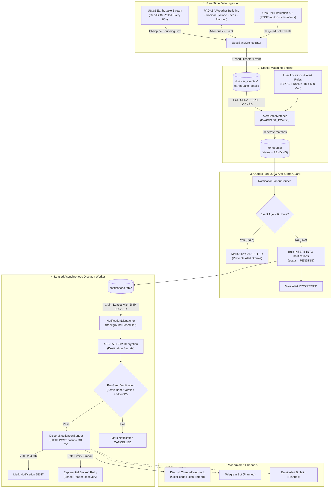

<h1 align="center">Tanaw</h1>

<p align="center">
  <strong>A Philippine based earthquake and typhoon alert system</strong>
</p>

<p align="center">
  
  
  
  
  
  
</p>

<br>

Tanaw is a disaster alert system for typhoons and earthquakes, built using Java 21 and Spring Boot 4. This project aims to provide alerts for its users whenever an earthquake occurs near their specified location or if there's an upcoming typhoon that'll affect their area through modern means.

> [!NOTE]
> **Note: Tanaw is currently still under development. This repository is made to show my journey while developing it.**

---

## Why does it exist?

An average of 20 typhoons per year enter the Philippine Area of Responsibility (PAR); roughly 8 to 9 of those typhoons hit or cross our land, leading to floods, landslides, and deaths of our fellow Filipinos. The Philippines also sits on top of the Pacific Ring of Fire, making our country prone to tectonic shifts causing earthquakes.

The aim of this project is to create an alert system for Filipinos that will notify them about disasters that occurred or will occur within their area and notify them through modern channels like email, Telegram, and Discord.

---

## Tech Stack

The planned tech stack for this project is Java 21 through the Spring Ecosystem (Spring Boot, Spring Data JPA, Spring Security), PostgreSQL for the database, Flyway as a database migration tool, and docker for creating containers. This will expand further more as new features and functions gets implemented.

<br>

<p align="center">
  
  &nbsp;&nbsp;&nbsp;&nbsp;
  
  &nbsp;&nbsp;&nbsp;&nbsp;
  
  &nbsp;&nbsp;&nbsp;&nbsp;
  
  &nbsp;&nbsp;&nbsp;&nbsp;
  
</p>

<p align="center">
  <sub>
    <b>Java</b>
    &nbsp;&nbsp;&nbsp;&nbsp;&nbsp;&nbsp;
    <b>Spring Ecosystem</b>
    &nbsp;&nbsp;&nbsp;&nbsp;
    <b>PostgreSQL</b>
    &nbsp;&nbsp;&nbsp;&nbsp;&nbsp;&nbsp;
    <b>Docker</b>
    &nbsp;&nbsp;&nbsp;&nbsp;&nbsp;&nbsp;&nbsp;&nbsp;&nbsp;
    <b>Flyway</b>
  </sub>
</p>

---

## Planned Features

| Feature                        |
| ------------------------------ |
| Earthquake monitoring          |
| Typhoon monitoring             |
| PSGC-based geographic matching |
| PostGIS radius queries         |
| Email notifications            |
| Discord notifications          |
| Telegram notifications         |

---

## Feature Implementation Status

To provide visibility into the development journey, here is how each planned capability is progressing:

| Feature | Status | Implementation Details |
| :--- | :---: | :--- |
| **Earthquake Monitoring** | `Operational` | Automated real-time ingestion from USGS GeoJSON feeds filtered to the Philippine coordinate bounding box (Lat 4.0°–21.5°N, Lon 116.0°–128.0°E). |
| **Typhoon Monitoring** | `Planned` | Scraper and ingestion pipeline planned for PAGASA tropical cyclone bulletins, track forecasts, and storm signals. |
| **PSGC Geographic Matching** | `Operational` | Full administrative hierarchy for the Philippine Standard Geographic Code (Region $\rightarrow$ Province $\rightarrow$ City/Municipality $\rightarrow$ Barangay). |
| **PostGIS Radius Queries** | `Operational` | High-precision geodetic proximity calculations (`ST_DWithin` & `ST_Distance`) comparing disaster coordinates against user monitored places. |
| **Discord Notifications** | `Operational` | Live delivery via Discord webhooks with rich embeds, epicentral distance calculation, magnitude severity colors, and SSRF defense. |
| **Telegram Notifications** | `Planned` | Telegram Bot transport adapter planned atop Tanaw's plug-and-play notification channel architecture. |
| **Email Notifications** | `Planned` | Transactional email bulletins planned for broader community emergency broadcasts. |
| **Operator Disaster Simulation** | `Operational` | Dedicated drill API (`/api/ops/simulations/earthquake`) to trigger simulated earthquakes and verify the alert pipeline on demand. |

---

## System Architecture & Processing Pipeline

Tanaw decouples external feeds, spatial computation, and third-party deliveries into independent, self-healing pipeline stages:



---

## Unique Engineering & Architectural Features

### 1. Philippine Standard Geographic Code (PSGC) Integration
Unlike global alert systems that only understand raw coordinates or foreign zip codes, Tanaw is built around the **official Philippine administrative structure**:
* **Hierarchical Geography:** Models administrative divisions across Regions, Provinces, Cities/Municipalities, and Barangays.
* **Contextual Places:** Users can associate monitored places (e.g., *Home in Quezon City*, *Work in BGC*, *Parents' House in Albay*) directly with their official PSGC code alongside precise GPS coordinates.

### 2. High-Precision PostGIS Spatial Radius Queries
Disaster impact zones do not adhere to flat, rectangular bounding boxes:
* **True Geodetic Distance:** Earthquake epicenters and user locations are indexed as spherical geodetic geometries (`geometry(Point, 4326)`).
* **`ST_DWithin` & `ST_Distance`:** The matching engine calculates real-world spherical distances in meters, allowing users to configure custom thresholds per location (e.g., *"Notify me if an earthquake $\ge$ Magnitude 5.0 strikes within 100 km of my workplace"*).
* **Concurrency Locking (`SKIP LOCKED`):** Batch matchers operate using `FOR UPDATE SKIP LOCKED`, allowing horizontal worker scaling without duplicate match calculations or thread contention.

### 3. Disaster-Grade Fault Isolation & Transactional Outbox
In emergency alerting, **at-least-once delivery** and **fault isolation** are non-negotiable invariants:
* **Decoupled Failure Domains:** A third-party network timeout, slow HTTP endpoint, or Discord webhook rate limit will **never** roll back an earthquake event, block USGS ingestion, or exhaust database connections.
* **Non-Transactional External I/O:** HTTP dispatches to external delivery channels execute strictly outside database transactions, protecting database connection pools from slow upstream networks.
* **Leased Background Claiming:** Background workers claim notification batches using database leases (`locked_until`). If a worker abruptly crashes mid-flight, a **Lease Reaper** reclaims expired leases so no critical emergency warning is dropped.
* **Anti-Storm Staleness Guard:** In the event of system recovery after extended downtime, events older than 6 hours are automatically cancelled, preventing confusing alert storms for past events.

### 4. Zero-Trust Webhook & Destination Security
Because users configure custom delivery channels (such as personal Discord channel webhooks), Tanaw enforces strict data privacy:
* **AES-256-GCM Authenticated Encryption:** Webhook URLs and transport tokens are encrypted at rest before being saved to PostgreSQL, and decrypted in-memory only immediately prior to HTTP dispatch.
* **Automated Credential Masking:** All API responses, exceptions, and worker logs mask webhook secrets (`https://discord.com/api/webhooks/1234567890/*****`).
* **SSRF Defense:** Destination validators enforce valid target hostnames to block Server-Side Request Forgery attempts towards internal network infrastructure.
* **Mention Spam Suppression:** Discord payloads explicitly enforce `allowed_mentions: { parse: [] }` to prevent malicious actors from triggering unauthorized `@everyone` or `@here` mass pings.

### 5. Operator Disaster Simulation & Drill Engine (Ops API)
A disaster alerting system cannot only be tested when a real earthquake strikes:
* **Simulated Earthquake Injections:** An operational endpoint (`/api/ops/simulations/earthquake`) allows developers and emergency response coordinators to simulate seismic events of any magnitude and distance against specific alert rules.
* **Isolated Security Boundary:** Simulation endpoints are decoupled from public user traffic and secured via a dedicated `X-Ops-Key` authentication filter.
* **Full Pipeline Verification:** Simulating an event exercises the entire production pipeline—from event ingestion and PostGIS spatial proximity calculations, through the outbox fanout, to live Discord embed delivery.

### 6. Modern, Actionable Discord Alerts
Disaster alerts need to be immediately legible and actionable in high-stress moments:
* **Visual Severity Coding:** Embed colors adapt dynamically to the earthquake's magnitude (green for minor tremors, orange for moderate shocks, vivid red for severe seismic events).
* **Key Disaster Telemetry:** Outlines the earthquake's exact magnitude, depth of focus, epicentral distance to the user's monitored place, precise timestamp, and a direct link to geographical map coordinates.
* **Extensible Notification SPI:** The delivery architecture uses an extensible `NotificationSender` SPI, allowing upcoming channels like **Telegram Bots** and **Email Services** to plug in cleanly without modifying core engine logic.

---

## Domain Architecture & Package Design

Tanaw follows clean architecture with domain-driven packaging, keeping domain concepts decoupled:

```text
dev.romulus_lanceues.tanaw_api/
├── alert/               # Alert matching rules, batch matcher, and alert entities
│   └── rule/            # User-configured alert thresholds (magnitude, radius in km)
├── disaster/            # Core disaster event models and specialized earthquake details
├── geo/                 # PostGIS spatial geometry utilities and geographic calculations
├── ingestion/           # Scheduled external data synchronization
│   └── usgs/            # USGS GeoJSON feed connector and deduplication logic
├── location/            # User monitored places and geographic coordinates
├── notification/        # Resilient notification engine
│   ├── channel/         # Extensible transport contracts (NotificationSender SPI)
│   │   └── discord/     # Discord webhook adapter, rich embed formatters, and sanitizers
│   ├── destination/     # AES-256-GCM destination encryption & credential masking
│   ├── dispatch/        # Transactional outbox fanout, leased claiming worker, and retry policy
│   └── endpoint/        # User notification endpoint registration and verification
├── ops/                 # Operational disaster simulation endpoints and drill tooling
├── psgc/                # Philippine Standard Geographic Code loader and hierarchy
├── shared/              # Security configs, CORS, RFC 7807 problem details, and OpenAPI
└── user/                # User accounts, authentication state, and session management
```

---

## License

This project is licensed under the [MIT License](LICENSE).
